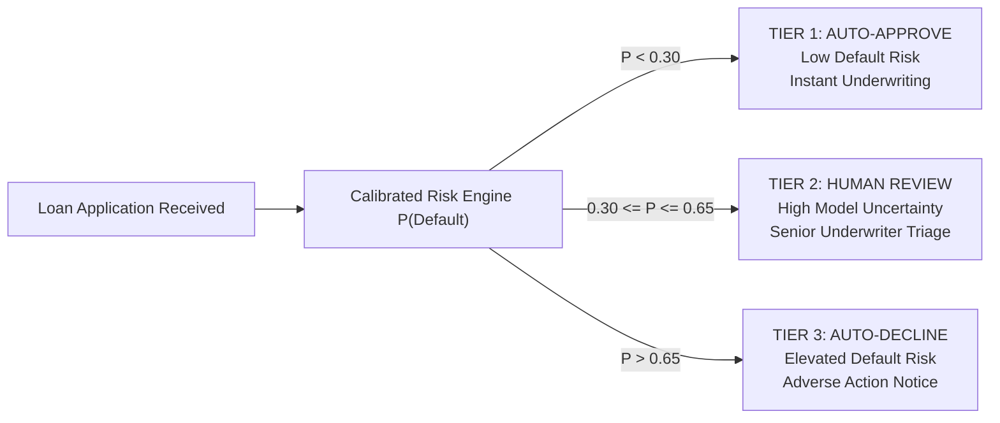

# Underwriting Decision Sheet & Adverse Action Disclosure Template
**Project**: Explainable Machine Learning for Credit Default Risk Prediction using SHAP and Tree Ensembles  
**Course**: University Machine Learning (Lab Project)  
**Governance Framework**: Fair Credit Reporting Act (FCRA § 615(a)), Equal Credit Opportunity Act (ECOA / Regulation B)

---

## 1. Regulatory Context & Framework
Under federal consumer financial regulations, when a financial institution takes an **adverse action** (such as denying credit, reducing credit limits, or offering credit on less favorable terms), it is legally obligated to provide the consumer with a written statement containing:
1. The **exact credit score / default probability** utilized in the decision.
2. The **numerical range** of possible scores under that model.
3. The **key factors (top 4)** that adversely affected the credit evaluation, listed in order of relative importance.
4. Information regarding the consumer's right to inspect their credit report and contest inaccuracies.

This Underwriting Decision Sheet serves as the standard operational audit template connecting our **Platt-calibrated XGBoost model** and **SHAP explainability engine** to credit underwriters and loan applicants.

---

## 2. Multi-Tier Underwriting Decision Policy

Our credit risk engine operates a 3-tier risk triage protocol designed to balance automation efficiency with risk governance:



| Decision Tier | Calibrated Default Risk $P(\text{Default})$ | Operational Action | Customer Communication |
|---|---|---|---|
| **Tier 1: Auto-Approve** | $P < 0.30$ | Automated approval; immediate terms generation | Approval letter with approved rate & credit line |
| **Tier 2: Underwriter Review** | $0.30 \le P \le 0.65$ | Sent to human underwriter queue; manual inspection of bank statements and collateral | Under review notice (decision within 48 hours) |
| **Tier 3: Auto-Decline** | $P > 0.65$ | Automatic credit denial | Official FCRA Adverse Action Disclosure Notice |

---

## 3. Standard Underwriting Decision Sheet Template

```
========================================================================================
                      CREDIT RISK UNDERWRITING DECISION SHEET
========================================================================================

APPLICATION DETAILS:
  Application ID:               APP-[XXXXXXXX]
  Application Date:             YYYY-MM-DD
  Requested Loan Amount:        [Amount in Currency]
  Requested Term:               [Duration in Months]
  Intended Purpose:             [Car / Education / Business / Consumer Goods]

MODEL EVALUATION SUMMARY:
  Champion Model Architecture:  XGBoost Classifier (Stratified 5-Fold Tuned)
  Calibration Method:           Platt Scaling (Sigmoid Cross-Validation)
  Brier Score (Calibrated):     0.1570 (vs 0.1740 uncalibrated)
  Calibrated Default Risk:      [XX.X]%
  Confidence / Margin:          [High / Uncertain / Low]
  Initial System Disposition:   [AUTO-APPROVE / HUMAN REVIEW / AUTO-DECLINE]

LOCAL EXPLAINABILITY ATTRIBUTION (SHAP BASELINE E[f(x)] = [Base Log-Odds]):
  Rank | Feature Name              | Feature Value | SHAP Impact (Δ log-odds) | Risk Direction
  -----+---------------------------+---------------+--------------------------+---------------
   1   | [Top Risk Factor]         | [Val 1]       | +[0.XX]                  | Increases Risk
   2   | [Second Risk Factor]      | [Val 2]       | +[0.XX]                  | Increases Risk
   3   | [Third Risk Factor]       | [Val 3]       | +[0.XX]                  | Increases Risk
   4   | [Fourth Risk Factor]      | [Val 4]       | +[0.XX]                  | Increases Risk
  -----+---------------------------+---------------+--------------------------+---------------
  Mitigating Factor (if any):      | [Val M]       | -[0.XX]                  | Decreases Risk

UNDERWRITER SIGN-OFF (For Tier 2 Cases Only):
  Underwriter Name:             _______________________________________
  Final Decision:               [ ] APPROVED    [ ] CONDITIONALLY APPROVED    [ ] DECLINED
  Stipulations / Overrides:     _______________________________________
  Date Signed:                  YYYY-MM-DD
========================================================================================
```

---

## 4. Empirical Case Studies from Model Test Partition

### Case Study 1: Auto-Declined Applicant (Applicant #37)
- **Applicant Profile**:
  - Requested Loan Term: **48 months** (Long duration)
  - Requested Credit Amount: **3,915 DM**
  - Checking Account Status: **`< 0 DM` (Overdrawn / Negative)**
  - Savings Account Status: **`< 100 DM`**
  - Installment Rate: **4% of disposable income**
  - Age: **25 years**
- **Model Output**:
  - Calibrated Default Probability $P(\text{Default})$: **74.5%**
  - Disposition: **AUTO-DECLINED (Tier 3)**
- **SHAP Local Risk Decomposition**:

| Rank | Factor Code | Observed Value | SHAP Impact | Regulatory Disclosure Statement (FCRA Disclosed Reason) |
|---|---|---|---|---|
| **1** | `duration` | 48 months | **+0.795** | **Duration of requested loan term is excessively long relative to risk profile.** |
| **2** | `checking_status_no_checking` | False (0.0) | **+0.434** | **Status of checking account is low, overdrawn, or absent.** |
| **3** | `credit_amount` | 3,915 DM | **+0.404** | **Requested credit amount is high relative to borrower repayment capacity.** |
| **4** | `checking_status_lt_0` | True (1.0) | **+0.230** | **Overdrawn checking account balance indicates immediate liquidity distress.** |

#### Official Adverse Action Notice for Applicant #37:
> **STATEMENT OF ADVERSE ACTION**  
> *Dear Applicant, thank you for your recent loan application. We regret to inform you that we are unable to approve your application for credit at this time. Our decision was made in whole or in part based on an automated risk model (Calibrated XGBoost Ensemble, Version 1.0). In accordance with the Fair Credit Reporting Act, the key factors that adversely contributed to this determination are:*
> 1. *Extended duration of the requested loan repayment term (48 months).*
> 2. *Existing checking account status with active overdrawn balance (< 0 DM).*
> 3. *High loan principal amount requested relative to demonstrated liquid asset coverage.*
> 4. *Insufficient cash reserves in liquid deposit accounts.*
> 
> *You have the right to request a free copy of your credit disclosure within 60 days.*

---

### Case Study 2: Borderline Case Triaged for Human Underwriter Review (Applicant #3)
- **Applicant Profile**:
  - Requested Loan Term: **24 months**
  - Requested Credit Amount: **2,835 DM**
  - Checking Account Status: **`< 0 DM` (Overdrawn)**
  - Savings Account Status: **`< 100 DM`**
  - Credit History: **All existing credits paid back properly**
  - Employment Duration: **4 to 7 years with current employer**
  - Property: **Car**
- **Model Output**:
  - Calibrated Default Probability $P(\text{Default})$: **46.6%** (Borderline zone: $0.30 \le P \le 0.65$)
  - Disposition: **HUMAN UNDERWRITER REVIEW (Tier 2)**
- **SHAP Local Risk Decomposition**:
  - **Negative Factors (Pushed Toward Default)**:
    1. Overdrawn checking status (`checking_status_lt_0`): $+0.279$ SHAP.
    2. Modest savings reserve (`savings_status_lt_100`): $+0.239$ SHAP.
  - **Mitigating Factors (Pushed Toward Creditworthiness)**:
    1. Stable 5-year employment tenure (`employment_4_le_X_lt_7`): $-0.312$ SHAP.
    2. Flawless historical repayment record (`credit_history_all_paid`): $-0.265$ SHAP.
- **Underwriter Protocol & Resolution**:
  - *Automated system halts auto-denial.*
  - *Human Underwriter Action*: Underwriter verifies the applicant's current monthly salary slips and requests 3 months of banking statements to check if the overdrawn checking status was a temporary anomaly.
  - *Mitigation Option*: If payroll deposits confirm stable income, offer conditional approval with a reduced term (12 months instead of 24) or require an automatic debit payment plan.

---

### Case Study 3: Auto-Approved Applicant (Applicant #1)
- **Applicant Profile**:
  - Requested Loan Term: **12 months**
  - Requested Credit Amount: **1,200 DM**
  - Checking Account Status: **`no checking account balance deficit` (clean status)**
  - Savings Account Status: **`>= 1000 DM`**
  - Credit History: **Critical / Other existing accounts paid to date**
  - Employment: **`>= 7 years`**
  - Housing: **Owns personal residence**
- **Model Output**:
  - Calibrated Default Probability $P(\text{Default})$: **14.0%**
  - Disposition: **AUTO-APPROVE (Tier 1)**
- **SHAP Local Risk Decomposition**:
  - Significant negative SHAP values (protective factors):
    - Substantial liquid reserves (`savings_status_ge_1000`): $-0.620$ SHAP.
    - Long-term stable employment (`employment_ge_7`): $-0.445$ SHAP.
    - Short repayment term (`duration=12`): $-0.380$ SHAP.
    - Homeownership (`housing_own`): $-0.290$ SHAP.
  - *Result*: Approved instantly at preferred prime interest rate tier.

---

## 5. Summary Guidelines for University Oral Presentation
When presenting this deliverable to the grading committee:
1. **Highlight the Legal Gap**: Explain why black-box deep learning or unexplainable models cannot be deployed in consumer lending without violating FCRA and ECOA.
2. **Demonstrate Additive Attribution**: Show that SHAP values sum up linearly from the base expected rate to the exact model output:
   $$\ln \left(\frac{P(\text{Default})}{1 - P(\text{Default})}\right) = \phi_0 + \sum_{j=1}^{M} \phi_j(x)$$
3. **Emphasize Platt Scaling**: Illustrate that raw tree scores do not reflect true statistical odds; calibration reduces the Brier score and drops the False Positive Rate (denying good borrowers) by more than **50%** (from $20.7\%$ down to $9.3\%$).
4. **Walk through the Case Studies**: Point to the exact waterfall plot and the resulting Adverse Action statement for Applicant #37.
